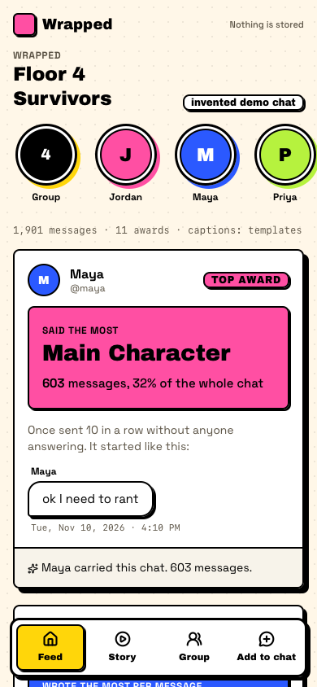
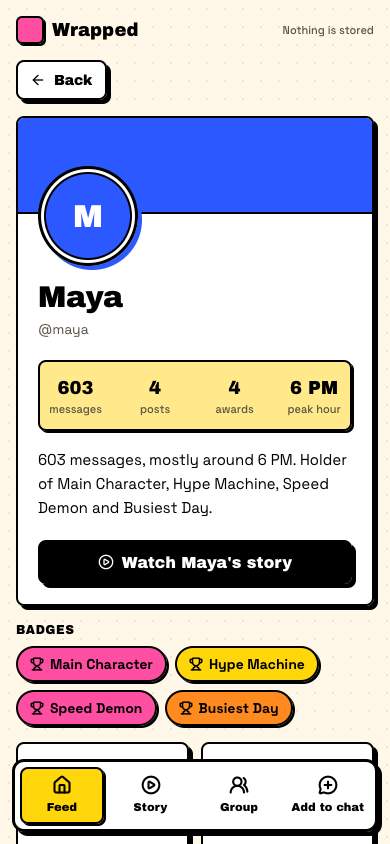
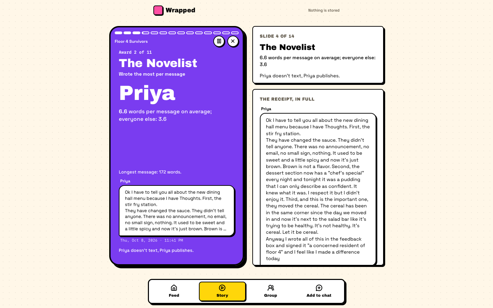

# Group Chat Wrapped

Spotify Wrapped for your group chat: who said "omw" while very much not on the way, who sends paragraphs at 3 AM, whose questions get left on read. Eleven awards, each backed by a real quoted message.
In Discord, friends run `/wrapped optin`, anyone runs `/wrapped run`, and the story is posted back into the channel.
Only people who opted in are named or quoted. Everyone else counts as "someone".

Team: Dharsan Kesavan ([contactdharsan-blip](https://github.com/contactdharsan-blip)), Jauwaad Shams
([JaShams](https://github.com/JaShams)), Lovinder Singh ([singhLovinder](https://github.com/singhLovinder)).
Cubbie Hackathon, Track 3 (group chat assistant).

<p>
  
  
</p>


The screens are the web app playing the invented demo chat.

## Use it in Discord

In a channel the bot has been added to (setup is below):

1. Everyone who wants to be in it runs `/wrapped optin`. `/wrapped optout` takes you back out.
2. Anyone runs `/wrapped run`. The bot reads the newest 20,000 messages (`--limit` changes that) with a
   progress message, then posts the slides ten per message, the MP4 if it's under 10 MB, and then one
   embed per award: the winner's colour, the numbers, the receipt and a caption.
3. `/wrapped me` posts your own profile card as an embed: messages, posts, awards, peak hour, badges,
   top emoji and top words. If you haven't opted in, it tells you privately to run `/wrapped optin`
   and reads nothing. `--web-url <url>` adds a link to the web app on every embed.

The bot has only been tested against fakes so far, never against a live server (see Real vs not yet).

### Set up the bot

1. In the [Developer Portal](https://discord.com/developers/applications), create an application, add a
   bot, and under **Bot → Privileged Gateway Intents** switch on **Message Content Intent**.
2. Put the bot token in the Keychain (it prompts for the token, so it never lands in your shell history):

   ```sh
   security add-generic-password -a hercules -s discord-bot-token -w
   ```

   The bot reads it at startup into memory only. It never prints, logs or writes it.
3. Invite the bot. Under **OAuth2 → URL Generator**, tick the scopes `bot` and `applications.commands`,
   and the bot permissions **View Channels**, **Read Message History**, **Send Messages** and
   **Attach Files** (permissions integer `101376`). The URL looks like:

   ```text
   https://discord.com/oauth2/authorize?client_id=<APPLICATION_ID>&scope=bot+applications.commands&permissions=101376
   ```

4. Install and run (Python 3.12+, `discord.py` pinned in `pyproject.toml`):

   ```sh
   uv venv --python 3.12 .venv
   uv pip install --python .venv/bin/python -r pyproject.toml
   .venv/bin/python -m wrapped.platforms.discord_bot --guild <your test server id>
   ```

   `--guild` registers the commands in that server at once. Without it they're global, and Discord
   can take up to an hour to show them.

Opt-ins are kept per channel in `~/.config/group-chat-wrapped/discord-optins.json`. A run works in a
temporary folder that is deleted after posting. Rendering needs Node, WebKit and ffmpeg on the bot's
machine (see Requirements).

## What it does

It reads a chat's history and makes a short vertical story: the group's numbers, then eleven awards
(Main Character, The Novelist, 3 AM Philosopher, "omw" (they were not), Left On Read, Hype Machine,
Speed Demon, The Ghost, Emoji of the Semester, Group Word, Busiest Day). Each award comes with a
**receipt**, a real quoted message with its date, so you can check it's true.

The awards are counted, not generated, and ties are broken the same way every time. The rules are in
`PLAN.md` and `wrapped/stats.py`. Awards are only among people who opted in: when someone who didn't
opt in did more, the award's numbers end with "the most (or fastest, or fewest) among people who opted
in". One person never wins both Main Character and The Ghost.

Output, in `out/`:

- `slides.html`: every slide on one self-contained page (1080x1920 each)
- `slide-01.png` …: one PNG per slide, rendered in WebKit
- `wrapped.mp4`: the slides with a quick crossfade, about 2.5 s each
- `stats.json`: the numbers and awards behind the slides

Content stays out of the bottom 350 px and right 120 px, where TikTok, Reels and Stories draw
their buttons. The renderer measures every slide and warns if anything crosses that line.

## Consent and privacy

What is guaranteed:

- Only people who opted in can win, be quoted, or be named. Everyone else still counts in the group
  totals, as "someone".
- Opt-in names match exactly. A name that differs only in case matches only when one person in the chat
  has it, so a "maya" never inherits "Maya"'s consent.
- In quoted text, the names of people who didn't opt in are replaced with "someone":
  - their full name, and each part of it with 3+ letters, in any case;
  - a part that is an ordinary English word ("Will", "Grace") only when written like a name, so
    "I will be there" stays as written;
  - capitalised nicknames that start their first name ("Kay" for Kayla), except ordinary words and
    names of people who opted in;
  - phone numbers (10 to 15 digits) and @-mentions made of digits, always.
- Profile top words and the Group Word never use those names or nicknames.
- Discord: a mention (`<@id>`) is resolved when the message is read: someone who opted in becomes
  `@name`, anyone else "someone". People who didn't opt in are tracked by their user id, never by their
  display name, so taking an opted-in member's display name doesn't merge you into them.

What isn't: redaction works from names, so a nickname that doesn't start the first name ("Bob" for
Robert, "Will" for William), a name that is an ordinary word written in ALL CAPS ("WILL"), a
misspelling, or a description ("her roommate") can still appear inside a quote from someone who opted
in. When it's unsure it redacts: an opted-in member's name is replaced too if someone who didn't opt in
shares it, a month written "Jan" is replaced when a hidden member is called Janet, and so is a date
and time written with dashes ("2026-10-24 10:30"), which looks like a phone number.

- The CLI runs locally, with no network calls and no accounts. Nothing is uploaded. The Discord bot
  and the iMessage bridge post the finished slides back into the chat they were run in, and nowhere else.
- The repo ships an **invented** demo chat (`demo/demo-chat.txt`, made by
  `demo/make_demo_chat.py`). Never commit a real chat.

## Real vs not yet

- **Real and tested:** the counting and redaction pipeline, the CLI on WhatsApp, DiscordChatExporter,
  CSV and Instagram exports, the slide renderer (WebKit and ffmpeg), and the web app (a WebKit smoke
  test drives it at phone and desktop sizes).
- **Discord bot:** tested only against fake Discord objects (`tests/test_discord_bot.py`,
  `tests/test_discord_social.py`). It has never been connected to a live server.
- **Captions and bios** are templates unless you pass `--claude`, which needs an Anthropic key in the
  Keychain.
- **iMessage bridge:** reads `chat.db` and sends through Messages with AppleScript. It is tested
  against a temporary `chat.db` with sending stubbed out; nothing in the repo shows a live send.
- **Instagram:** read from Instagram's own data export only; no bot can join an Instagram chat.

## Run it on a WhatsApp export (CLI)

In WhatsApp, open the chat, then **Export chat → Without media**, and save the `.txt`.

```sh
python3 -m wrapped.cli "WhatsApp Chat with Friends.txt" --format whatsapp \
    --optin "Maya,Jordan,Priya,Theo" --name "Floor 4 Survivors" --out out/
```

The names must match how they appear in the export. Both export layouts work:
`[10/24/26, 9:41:03 PM] Name: text` (iPhone) and `10/24/26, 21:41 - Name: text` (Android).
Dates are read month-first unless more lines read in date order day-first, so one line pasted from
a chat with the other date order doesn't flip the file. A line whose date can't exist that way round
(including 2/30) is kept as text of the message before it. An export with no messages in it stops
with "no messages found" and exit code 1.

The other formats: `--format discord` for a DiscordChatExporter JSON file, `--format csv` for a
CSV with a `timestamp,author,text` header, and `--format instagram` for Instagram's JSON export
(see Other platforms).

Use `--no-render` to make only `stats.json` and `slides.html`.

The demo:

```sh
python3 -m wrapped.cli demo/demo-chat.txt --format whatsapp --optin "Maya,Jordan,Priya,Theo" \
    --name "Floor 4 Survivors" --out out/
```

## Other platforms

The iMessage bridge and the Instagram importer run the same pipeline and the same consent rule as the
Discord bot: only people who opted in are named.

### iMessage (macOS)

The bridge runs on the Mac of someone who is in the group chat.

1. Give your terminal **Full Disk Access** (System Settings → Privacy & Security → Full Disk Access),
   or it can't read `~/Library/Messages/chat.db`. The first real send asks to let the terminal control
   **Messages** (Automation); allow it.
2. Find the group's id. This prints group chats only (guid, name, size, last activity) and never
   message text:

   ```sh
   python3 -m wrapped.platforms.imessage --list-chats
   ```

3. Optionally map phone numbers and emails to names in a JSON file. Anyone not in it shows up as their
   phone number or email, so map everyone who might opt in:

   ```json
   {"+15551234567": "Maya", "jordan@example.com": "Jordan"}
   ```

4. Run it with `--dry-run` first. It prints what it would send instead of sending:

   ```sh
   python3 -m wrapped.platforms.imessage --chat-guid "any;+;chat123456789" \
       --names names.json --me "Dharsan" --dry-run
   ```

5. Then drop `--dry-run`. In the group, members type `wrapped optin` (or `wrapped optout`), and
   anyone types `wrapped`. The bridge checks every 3 seconds, then sends a short text and the slides.

It only ever sends into the one chat id it was started with, and it refuses an id that isn't a group
(`;+;`). Commands posted before the first start are ignored. One Wrapped per ten minutes. State (the
last row seen and the opt-ins) is in `~/.config/group-chat-wrapped/imessage-<hash>.json`. Slides are
copied to `~/Pictures/group-chat-wrapped/` before sending, because Messages uploads after the script
returns and may not read files from other folders.

### Instagram

No bot can join an Instagram group chat, so this works from Instagram's own export.

1. In Instagram: **Settings → Accounts Center → Your information and permissions → Download your
   information → Download or transfer information**, choose your account, **Some of your
   information → Messages**, **Download to device**, format **JSON** (not HTML), and a date range
   covering the semester. Instagram emails you when it's ready.
2. Unzip it. The chat is a folder like `your_instagram_activity/messages/inbox/<chatname>_<id>/`,
   holding `message_1.json` (and `message_2.json`… for long chats).
3. Run the CLI on that folder (or on one `message_N.json`):

   ```sh
   python3 -m wrapped.cli "your_instagram_activity/messages/inbox/floor4_123" --format instagram \
       --optin "Maya,Jordan,Renée,Theo" --name "Floor 4 Survivors" --out out/
   ```

   Names are the `sender_name` values (the display names in the chat). The importer fixes Instagram's
   garbled emoji and accents.
4. The slides are 1080x1920, the Stories size: post `out/slide-01.png` … as Stories, or `out/wrapped.mp4`
   as one, and tag the friends who opted in.

The test fixture `tests/fixtures/instagram/floor4/` is an invented chat in the export's shape.

## Web app

The companion to the bots, and the way in for Instagram and WhatsApp: drop a chat export, tick who
agreed to be named, and get a feed of award posts, a profile per opted-in member, an Instagram-style
story player, and a group page. Nothing is stored: uploads are parsed in memory (20 MB cap) and never
written to disk or logged.

```sh
uv venv .venv && uv pip install --python .venv/bin/python fastapi uvicorn python-multipart httpx   # the "web" extra
npm --prefix web install
npm --prefix web run build           # web/dist
.venv/bin/python -m wrapped.server --port 8770   # serves web/dist and /api on http://127.0.0.1:8770
```

- `GET /api/demo` runs the invented demo chat. `POST /api/members` (multipart `file`, `format` =
  auto|whatsapp|discord|csv|instagram) lists members and message counts. `POST /api/wrapped` (`file`,
  `format`, `optin` repeated, `name`) returns the awards, the profiles (opted-in members only), the
  group page and the captions.
- `npm --prefix web run build:static` also bakes the demo into `web/dist/demo.json`. Served from a
  plain static host (no API), the app plays that demo and hides upload. `tests/test_web.py` checks
  the baked file matches `/api/demo`.
- Captions and profile bios are templates by default. `--claude` (on `wrapped.server`, `wrapped.cli`
  and the Discord bot) has Claude write them from the computed award fields only, with the API key read
  from the Keychain (service `anthropic-api-key`, account `hercules`); any error, refusal or caption
  with a number that isn't in its facts falls back to the template. Needs `pip install anthropic`.
- `node scripts/smoke_web.mjs` (after `build:static`) drives the app in Playwright WebKit at 390x844
  and 1440x900, uploads `demo/demo-chat.txt` with Jordan and Theo unticked and checks their names never
  reach the DOM, and writes screenshots to `out/screens/`. It starts and stops its own servers.

## Requirements

- Python 3.12+, standard library only, except the Discord bot, which needs `discord.py`
  (pinned in `pyproject.toml`).
- To render PNGs and the MP4: Node, `playwright-core` with its WebKit build, and `ffmpeg` on PATH.
  Set `PLAYWRIGHT_CORE` to the path of a `playwright-core` install. The default is a path on the
  author's machine (`wrapped/render.py`). Rendering uses WebKit only, never Chromium.

## Tests

```sh
python3 -m unittest discover -s tests
```

They run offline. The full-render test skips itself when Node or WebKit isn't available, and the
Discord wiring test skips itself when `discord.py` isn't installed (run
`.venv/bin/python -m unittest discover -s tests` to include it). The platform tests use fakes and a
temporary `chat.db`; nothing connects to Discord or sends an iMessage.
`tests/test_demo_story.py` locks the demo's story: each award goes to the friend it was written for.

## Notes

- Group Word compares the chat against a bundled list of about 2,900 common English words
  (`wrapped/data/english_top.txt`). The list was written by hand for this repo, and its ranks are
  approximate.
- The 1–5 AM award uses the clock time shown in the export.
